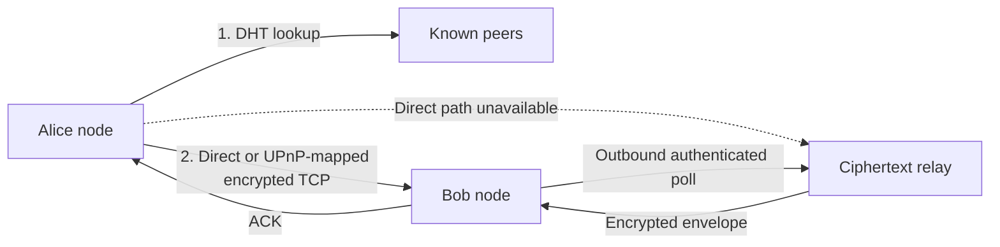

# CNP2P — Encrypted Peer-to-Peer Chat

CNP2P is an educational peer-to-peer chat application written in Python. Every
running instance is a network node: it accepts connections, discovers peers,
answers distributed lookups, and sends end-to-end encrypted messages, images,
and files directly whenever the destination is reachable.

When direct delivery is blocked by NAT or the recipient is offline, the sender
can place the encrypted envelope on a configured relay. The relay stores only
ciphertext and cannot decrypt the conversation.

## Features

- Persistent, key-derived 160-bit node identities
- Ed25519 signatures and authenticated peer records
- X25519 key agreement with HKDF-SHA256 key derivation
- ChaCha20-Poly1305 authenticated message encryption
- Direct TCP delivery with acknowledgements and retries
- Delivered and read receipts (read receipts can be turned off)
- Encrypted image and file sharing with progress, resume, and integrity checks
- Automatic resend of files when an offline recipient comes back
- Persistent local conversation history and contacts
- Invite codes, nicknames, and safety numbers for contact verification
- Duplicate-message suppression
- Manual bootstrap and UDP local-network discovery
- Kademlia-inspired routing and iterative node lookup
- Relay-assisted connectivity for NAT-restricted nodes
- Persistent encrypted offline-message queues
- Signed relay fetch and deletion requests
- Optional RFC 5389 STUN endpoint diagnostics
- Automatic UPnP IGD TCP mapping with renewal and clean shutdown
- Electron desktop app with an isolated renderer: unread badges, desktop
  notifications, drag-and-drop and pasted images, inline image previews,
  and light and dark themes
- Standalone Windows and Linux builds with the Python networking engine embedded
- Bounded protocol frames, routing-table cleanup, and relay expiry limits

## Contents

- [Requirements](#requirements)
- [Desktop app](#desktop-app)
- [Command-line installation](#command-line-installation)
- [Sharing images and files](#sharing-images-and-files)
- [First local chat](#first-local-chat)
- [Chat over a LAN](#chat-over-a-lan)
- [Relay, NAT, and offline messaging](#relay-nat-and-offline-messaging)
- [STUN diagnostics](#stun-diagnostics)
- [Interactive commands](#interactive-commands)
- [Command-line options](#command-line-options)
- [How the network works](#how-the-network-works)
- [Identity and encryption](#identity-and-encryption)
- [Data files and backups](#data-files-and-backups)
- [Testing](#testing)
- [Troubleshooting](#troubleshooting)
- [Limitations](#limitations)
- [Roadmap](#roadmap)

## Requirements

- Python 3.11 or newer
- `pip`
- Git, if cloning from GitHub
- Node.js 20 or newer and npm, only for the Electron app
- A reachable TCP port for nodes accepting direct connections
- A publicly reachable machine only when operating an Internet relay

The only third-party Python dependency is
[`cryptography`](https://cryptography.io/). It is installed automatically by
`pip` from `pyproject.toml`.

Check the installed tools:

```powershell
python --version
python -m pip --version
git --version
node --version
npm --version
```

On systems where Python 3 is invoked as `python3`, substitute `python3` for
`python` in the commands below.

## Desktop app

The Electron app is the simplest way to use CNP2P. It uses a two-pane layout.
Conversations and nearby peers are on the left, and the selected encrypted
conversation is on the right. Network options are in Settings.

- **Add contact** (the `+` button) accepts an invite code or a plain
  `host:port`. Copy your own invite code from the bottom of the sidebar.
- **Contact details** (the ⓘ button in a conversation) shows the full node
  ID, a nickname field, and a 60-digit safety number. Compare the number with
  your contact in person or on a call, then mark them as verified.
- **Files** can be attached with the paper-clip button, dragged onto the
  conversation, or pasted from the clipboard.
- History, contacts, and received files are stored locally and survive
  restarts. Received files are in Settings → Files → *Open received files
  folder*.
- `Ctrl+K` searches conversations and peers. `Esc` closes panels.

### Run from source on Windows

```powershell
git clone https://github.com/AdityaVKochar/p2p-chat.git
cd p2p-chat

python -m venv .venv
Set-ExecutionPolicy -Scope Process -ExecutionPolicy Bypass
.venv\Scripts\Activate.ps1
python -m pip install --upgrade pip
python -m pip install -e ".[desktop]"

npm install
npm start
```

### Run from source on macOS or Linux

```bash
git clone https://github.com/AdityaVKochar/p2p-chat.git
cd p2p-chat

python3 -m venv .venv
source .venv/bin/activate
python -m pip install --upgrade pip
python -m pip install -e ".[desktop]"

npm install
npm start
```

On first launch, enter a display name. The app then shows your invite code to
share. Open Settings to configure a bootstrap peer, encrypted relay, STUN
server, LAN discovery, automatic port mapping, read receipts, notifications,
theme, or the largest file you accept.

### Run two instances on one computer

Each profile has its own identity, history, and settings:

```bash
CNP2P_PROFILE=alice npm start
CNP2P_PROFILE=bob npm start
```

On Windows PowerShell, use `$env:CNP2P_PROFILE="alice"; npm start`. Set the
listening port to `0` in one profile's Settings so the two nodes do not
compete for port 9000. With LAN discovery enabled, they find each other within
a few seconds.

### Linux and WSL system libraries

Electron needs the usual GTK and NSS desktop libraries. Minimal installs and
WSL distributions often lack them. If `npm start` reports a missing `.so`
file, install them:

```bash
# Debian and Ubuntu
sudo apt install libnss3 libatk-bridge2.0-0 libgtk-3-0 libgbm1 libasound2 libxss1
# Fedora
sudo dnf install nss atk at-spi2-atk cups-libs gtk3 mesa-libgbm alsa-lib libXScrnSaver
```

If npm skipped Electron's download step, `npm start` reports that Electron
failed to install. In that case run `node node_modules/electron/install.js`
once.

### Build the Windows installer

```powershell
python -m pip install -e ".[desktop]"
npm install
npm run build:win
```

The NSIS installer is written to `release/`. PyInstaller first bundles the
Python networking engine, cryptography library, and SQLite support; Electron
then embeds that executable. Users of the finished Windows build do not need
Python or Node.js.

### Build Linux packages

```bash
python -m pip install -e ".[desktop]"
npm install
npm run build:linux
```

This writes an AppImage and a `.deb` package to `release/`. Build each
platform on that platform: PyInstaller cannot cross-compile the networking
engine.

Tagging a commit `v*` and pushing it runs
[`.github/workflows/ci.yml`](.github/workflows/ci.yml). The workflow tests on
Windows and Linux, builds both installers, and attaches them to a GitHub
release. Every push and pull request runs the tests.

For a faster unpacked packaging check:

```powershell
npm run build:dir
```

## Command-line installation

### Windows PowerShell

```powershell
git clone https://github.com/AdityaVKochar/p2p-chat.git
cd p2p-chat

python -m venv .venv
Set-ExecutionPolicy -Scope Process -ExecutionPolicy Bypass
.venv\Scripts\Activate.ps1

python -m pip install --upgrade pip
python -m pip install -e .
```

The execution-policy command only affects the current PowerShell process. If
virtual-environment activation is already permitted, it may be omitted.

### Windows Command Prompt

```bat
git clone https://github.com/AdityaVKochar/p2p-chat.git
cd p2p-chat

python -m venv .venv
.venv\Scripts\activate.bat

python -m pip install --upgrade pip
python -m pip install -e .
```

### macOS and Linux

```bash
git clone https://github.com/AdityaVKochar/p2p-chat.git
cd p2p-chat

python3 -m venv .venv
source .venv/bin/activate

python -m pip install --upgrade pip
python -m pip install -e .
```

Verify the installation:

```powershell
cnp2p --help
```

If the `cnp2p` command is not found, ensure the virtual environment is active,
or run the equivalent module command:

```powershell
python -m cnp2p --help
```

## Sharing images and files

Files travel **directly** between the two devices, never through the relay:

1. The sender announces the file with an encrypted `FILE_OFFER`. The offer
   contains the name, size, SHA-256 digest, and a fresh random 256-bit file
   key.
2. The file is split into 32 KiB chunks. Each chunk is encrypted with
   ChaCha20-Poly1305 under the file key and bound to its position, so chunks
   cannot be reordered or swapped between transfers.
3. The recipient writes chunks to a partial file and reports which chunks it
   already has. An interrupted transfer therefore resumes where it stopped.
4. When every chunk has arrived, the recipient verifies the SHA-256 digest
   before the file appears in the conversation.

If the recipient is offline, the file waits on the sender's device and is sent
automatically the next time the two nodes see each other. Waiting files expire
after seven days. Either side can cancel a transfer.

The recipient's limit applies (100 MB by default, configurable in Settings).
Images (PNG, JPEG, GIF, WebP, and BMP) are previewed inline. Click an image
to open it full size.

From the command line:

```text
/file 8ac441 "~/Pictures/holiday photo.jpg"
```

## First local chat

This example runs two independent nodes on one computer. Each node must use a
different port and data directory.

Open terminal 1:

```powershell
cd p2p-chat
.venv\Scripts\Activate.ps1
cnp2p --name Alice --host 127.0.0.1 --advertise-host 127.0.0.1 --port 9101 --data-dir .demo/alice --no-lan
```

Open terminal 2:

```powershell
cd p2p-chat
.venv\Scripts\Activate.ps1
cnp2p --name Bob --host 127.0.0.1 --advertise-host 127.0.0.1 --port 9102 --data-dir .demo/bob --bootstrap 127.0.0.1:9101 --no-lan
```

On Bob's prompt, list the routing table:

```text
/peers
```

Copy Alice's node ID or use its unique displayed prefix:

```text
/msg ALICE_ID_PREFIX Hello Alice
```

Alice can reply using Bob's ID prefix. A successful direct message prints an
encrypted-delivery acknowledgement.

## Chat over a LAN

Nodes on the same local network can discover one another through UDP broadcast.
Start a node on each computer:

```powershell
cnp2p --name Alice --port 9000 --data-dir .cnp2p/alice
```

```powershell
cnp2p --name Bob --port 9000 --data-dir .cnp2p/bob
```

Wait several seconds, then run `/peers`. If broadcast discovery is blocked by
the network or operating-system firewall, bootstrap Bob with Alice's LAN IP:

```powershell
cnp2p --name Bob --port 9000 --data-dir .cnp2p/bob --bootstrap 192.168.1.20:9000
```

The receiving computer must permit inbound TCP traffic on the selected node
port. LAN discovery uses UDP port `37020`.

## Relay, NAT, and offline messaging

Direct TCP is always attempted first. With automatic port mapping enabled, a
compatible UPnP IGD gateway maps the listening TCP port; CNP2P advertises the
public endpoint, renews finite leases, and removes the mapping on clean
shutdown. If that path fails, both clients create outbound TCP connections to
the relay. This fallback works behind most NAT devices and restrictive inbound
firewalls.

### 1. Start a relay

Run this on a publicly reachable computer or server:

```bash
git clone https://github.com/AdityaVKochar/p2p-chat.git
cd p2p-chat
python3 -m venv .venv
source .venv/bin/activate
python -m pip install -e .

cnp2p \
  --name PublicRelay \
  --host 0.0.0.0 \
  --advertise-host relay.example.org \
  --port 9100 \
  --data-dir .relay \
  --relay-server \
  --no-lan \
  --no-history \
  --daemon
```

`--daemon` runs the node without the interactive prompt until it receives
SIGTERM or Ctrl+C, which suits a systemd service. `--no-history` keeps no
local history and refuses incoming files, so strangers cannot fill the relay's
disk. Allow inbound TCP port `9100` in the server firewall and cloud security
group. The relay queue is persisted in `.relay/relay.sqlite3`.

#### Deploy a relay on AWS

[`scripts/aws/deploy-relay.sh`](scripts/aws/deploy-relay.sh) deploys a relay
with the AWS CLI. It launches a `t4g.nano` running Amazon Linux 2023 and
installs CNP2P from GitHub at the current commit. The relay runs as a hardened
systemd service. The instance gets an Elastic IP, so its address stays the
same across restarts. The security group opens the relay port to everyone and
SSH only to your current IP.

```bash
./scripts/aws/deploy-relay.sh
```

The script prints the relay address and the SSH and log commands when it
finishes. Settings come from environment variables (`AWS_REGION`,
`INSTANCE_TYPE`, `RELAY_PORT`, `CNP2P_REF`, `ADMIN_CIDR`); the header of the
script describes each one. A nano instance, Elastic IP, and 8 GB volume cost
roughly US$7–8 per month. Remove everything with:

```bash
./scripts/aws/teardown-relay.sh
```

### 2. Configure the clients

Alice:

```powershell
cnp2p --name Alice --port 9101 --data-dir .alice --bootstrap relay.example.org:9100 --relay relay.example.org:9100
```

Bob:

```powershell
cnp2p --name Bob --port 9102 --data-dir .bob --bootstrap relay.example.org:9100 --relay relay.example.org:9100
```

Use the relay's actual hostname or public IP address in place of
`relay.example.org`.

### 3. Test offline delivery

1. Start Alice and Bob once so their signed peer records enter the routing
   network.
2. Stop Alice with `/quit`.
3. From Bob, send a message to Alice's node ID.
4. Bob first attempts direct delivery and then reports that the encrypted
   message was queued at the relay.
5. Restart Alice with the same `--data-dir` and `--relay` options.
6. Alice automatically polls the relay and decrypts the message locally.

Fetch immediately instead of waiting for the polling interval:

```text
/offline
```

Queued envelopes expire after seven days. A relay stores at most 1,000
envelopes for each recipient. Successful retrieval is followed by a signed
deletion request from the recipient.

## STUN diagnostics

STUN is optional and is used only to observe the public UDP address assigned by
a NAT device. Supply an RFC 5389-compatible server explicitly:

```powershell
cnp2p --name Alice --port 9101 --data-dir .alice --stun stun.example.org:3478
```

At the prompt:

```text
/nat
```

The result is diagnostic. This project does not implement direct ICE/TCP hole
punching. UPnP is the automatic direct-mapping path, and the configured relay
is the fallback when the gateway does not support mapping.

## Interactive commands

| Command | Description |
| --- | --- |
| `/id` | Display the complete local node ID. |
| `/peers` | List peers in the local routing table. |
| `/connect HOST:PORT` | Bootstrap through another running node. |
| `/find NODE_ID` | Perform a distributed lookup for a complete node ID. |
| `/msg ID_OR_PREFIX MESSAGE` | Encrypt and send a message. |
| `/file ID_OR_PREFIX PATH` | Send an encrypted file directly to a peer. |
| `/history ID_OR_PREFIX [N]` | Show the last N messages with a peer (default 20). |
| `/verify ID_OR_PREFIX` | Show the safety number to compare with a peer. |
| `/ping ID_OR_PREFIX` | Check direct reachability and round-trip time. |
| `/offline` | Poll configured relays for queued messages immediately. |
| `/nat` | Query the configured STUN server. |
| `/help` | Display command help. |
| `/quit` | Stop the node cleanly. |

Quotes may be used when the shell-like command parser needs to preserve spaces:

```text
/msg 8ac441 "This message is encrypted end to end"
```

## Command-line options

```text
--name NAME                    Required display name
--host HOST                    Local TCP bind address; default 0.0.0.0
--port PORT                    Local TCP listen port; default 9000
--advertise-host HOST          Address other peers should use
--bootstrap HOST:PORT          Initial peer; may be repeated
--data-dir DIRECTORY           Identity and relay-data directory
--relay HOST:PORT              Offline/NAT relay; may be repeated
--relay-server                 Enable persistent relay service on this node
--stun HOST:PORT               STUN server used by /nat
--upnp                         Request automatic TCP mapping from the router
--no-lan                       Disable UDP LAN discovery
--no-history                   Keep no local history; refuse incoming files
--daemon                       Run without the prompt until SIGTERM/Ctrl+C
```

Display the authoritative help for the installed version:

```powershell
cnp2p --help
```

## How the network works



Each node occupies a 160-bit keyspace. Its routing table groups known peers by
XOR distance in Kademlia-style buckets. A lookup queries up to three of the
closest unqueried nodes in each round and incorporates the signed peer records
they return.

Protocol frames are newline-delimited JSON over TCP:

- `HELLO` exchanges authenticated peer records.
- `FIND_NODE` and `NODES` perform distributed discovery.
- `CHAT` carries an encrypted envelope; plaintext is never placed in the frame.
  The encrypted payload is a text message or a delivered/read receipt.
- `ACK` confirms direct receipt.
- `FILE_OFFER`, `FILE_CHUNK`, and `FILE_COMPLETE` carry an encrypted file
  transfer. The responses are `FILE_ACCEPT`, `FILE_CHUNK_OK`, `FILE_DONE`, or
  `FILE_REJECT`.
- `RELAY_STORE` queues signed ciphertext.
- `RELAY_FETCH` and `RELAY_DELETE` require recipient signatures.

UDP broadcast is used only for LAN peer announcements; it never carries chat
content.

## Identity and encryption

On first startup, the node creates an Ed25519 signing key and an X25519
key-agreement key. The node ID is derived from the Ed25519 public key. The
identity signs the X25519 public key and relay capability, preventing silent key
substitution in a peer record.

For each message:

1. The sender performs X25519 key agreement with the recipient's public key.
2. HKDF-SHA256 derives a message-specific 256-bit key.
3. ChaCha20-Poly1305 encrypts and authenticates the text and timestamp with a
   fresh nonce.
4. Ed25519 signs the sender, recipient, message ID, nonce, and ciphertext.
5. The recipient verifies the signature before decrypting.

Files use a separate random key per transfer. The key is delivered inside the
encrypted file offer, so it is protected exactly like a chat message.

The **safety number** shown in contact details is derived from both users'
signing keys. Both people see the same 60 digits, and comparing them out of
band detects a substituted key.

The relay can observe metadata—including node IDs, message size, and timing—but
does not possess the key required to decrypt the text. See
[`docs/security-model.md`](docs/security-model.md) for the complete security
boundary.

## Data files and backups

The directory supplied through `--data-dir` contains:

| File | Purpose |
| --- | --- |
| `identity.json` | Long-term Ed25519 and X25519 private keys. |
| `history.sqlite3` | Local conversation history, contacts, nicknames, and transfer state. |
| `attachments/` | Received files; `attachments/sent/` keeps copies of sent files. |
| `relay.sqlite3` | Ciphertext queue, only on relay-enabled nodes. |

The desktop app keeps this directory under its user-data folder:
`%APPDATA%\cnp2p-desktop\node` on Windows and `~/.config/cnp2p-desktop/node`
on Linux. With `CNP2P_PROFILE=name` set, the folder is
`cnp2p-desktop-name` instead.

History and attachments are stored **unencrypted** on disk. Anyone who can
read your user profile can read them.

Do not commit data directories. The included `.gitignore` excludes common
local directories such as `.cnp2p/` and `.venv/`.

Treat `identity.json` like a password or private SSH key:

- Do not send it to another person.
- Do not place it in cloud-synced public folders.
- Back it up securely if the node ID must remain stable.
- Use a separate data directory for every node running on the same computer.

Deleting the identity file generates a new identity and node ID on the next
start. Legacy version-1 random-only identities are migrated once to new
key-bound identities.

## Testing

Create the environment and install the project first, then run:

```powershell
python -m unittest discover -s tests -v
```

The tests cover:

- Persistent cryptographic identities
- Confidentiality and ciphertext-tamper rejection
- RFC 5389 XOR-mapped-address parsing
- Three-node discovery and direct encrypted delivery
- Message acknowledgements and duplicate suppression
- Offline encrypted delivery through a persistent relay
- Relay recovery after process restart
- Encrypted payload kinds, receipts, and file-chunk binding
- Persistent history, unread counts, status transitions, and contacts after restart
- Delivered receipts via the relay, read receipts, and retrying failed messages
- File transfer integrity, tamper rejection, resume, cancellation, size limits,
  and automatic resend to a recipient who comes back online
- UPnP service discovery, public endpoint advertisement, and mapping cleanup
- XOR-distance routing behavior

Run the Python tests and a syntax check of the desktop scripts together:

```powershell
npm test
```

## Project structure

```text
p2p-chat/
├── docs/
│   ├── project-proposal.md
│   └── security-model.md
├── .github/workflows/ci.yml
├── desktop/
│   ├── assets/
│   ├── renderer/         # index.html, styles.css, util/state/chat/renderer.js
│   ├── main.js
│   └── preload.js
├── scripts/
│   ├── backend_entry.py
│   ├── build-backend.js
│   └── generate-icon.py
├── src/cnp2p/
│   ├── cli.py
│   ├── crypto.py
│   ├── discovery.py
│   ├── identity.py
│   ├── models.py
│   ├── nat.py
│   ├── node.py
│   ├── protocol.py
│   ├── relay.py
│   ├── routing.py
│   ├── store.py          # local history, contacts, transfer state
│   └── transfer.py       # chunked encrypted file transfer
├── tests/
├── package.json
├── package-lock.json
├── pyproject.toml
└── README.md
```

## Troubleshooting

### `cnp2p` is not recognized

Activate the virtual environment again or use:

```powershell
python -m cnp2p --name Alice --port 9101 --data-dir .alice
```

### Two local nodes have the same ID

They are using the same data directory. Stop both and restart them with unique
paths:

```powershell
cnp2p --name Alice --port 9101 --data-dir .demo/alice
cnp2p --name Bob --port 9102 --data-dir .demo/bob
```

### Peers do not appear automatically

- Wait at least five seconds for a LAN announcement.
- Confirm both devices are on the same broadcast network.
- Permit UDP port `37020` through the local firewall.
- Use `--bootstrap IP:PORT` if broadcast traffic is filtered.

### A direct message fails

- Run `/ping ID_PREFIX` to check the saved address.
- Confirm the recipient process is running.
- Verify its TCP port is allowed through the firewall.
- Configure the same reachable `--relay HOST:PORT` on both nodes when inbound
  connections are blocked.
- Try `--upnp` or enable automatic port mapping in desktop Settings when the
  router supports UPnP IGD.

### Offline messages are not received

- Restart the recipient with the same `--data-dir`; a new identity cannot read
  messages encrypted for the old identity.
- Confirm the relay address and port are correct.
- Run `/offline` to poll immediately.
- Confirm the relay was started with `--relay-server`.
- Check that the queue has not passed its seven-day expiry.

### A file stays "Waiting for … to come online"

The recipient could not be reached directly. Files never use the relay. The
transfer resumes automatically when the recipient announces itself on the LAN,
connects to you, or answers the periodic presence check. To retry sooner,
reconnect through *Add contact* or ping the contact from its details panel.

### Windows firewall

For a development node on TCP port 9101, an elevated PowerShell can add a rule:

```powershell
New-NetFirewallRule -DisplayName "CNP2P TCP 9101" -Direction Inbound -Protocol TCP -LocalPort 9101 -Action Allow
New-NetFirewallRule -DisplayName "CNP2P LAN Discovery" -Direction Inbound -Protocol UDP -LocalPort 37020 -Action Allow
```

Remove those example rules when they are no longer required:

```powershell
Remove-NetFirewallRule -DisplayName "CNP2P TCP 9101"
Remove-NetFirewallRule -DisplayName "CNP2P LAN Discovery"
```

### Linux firewall with UFW

```bash
sudo ufw allow 9100/tcp
sudo ufw allow 37020/udp
sudo ufw status
```

Only expose the ports required for the role of that computer.

## Limitations

This is an educational implementation, not a production messenger.

- Relay operators can observe node IDs, timing, and message sizes.
- Static X25519 identities do not provide forward secrecy after private-key
  compromise.
- Replay suppression is maintained within an active cache window.
- The application does not implement multi-device key management, key
  revocation, direct ICE hole punching, relay federation, traffic-analysis
  resistance, or group chat.
- Files need a direct path between the two devices. With neither UPnP nor a
  reachable port, files wait until both peers share a network.
- Local history and received files are not encrypted at rest.
- The protocol and cryptographic construction have not received an independent
  security audit.

For the academic abstract and objectives, see
[`docs/project-proposal.md`](docs/project-proposal.md).

## Roadmap

Planned features, roughly in order of value:

1. **Group chats.** Small groups using pairwise fan-out: each message is
   sealed separately for each member, with a signed member list.
2. **Forward secrecy.** X3DH key agreement and the Double Ratchet replace the
   static X25519 keys, so a stolen key cannot decrypt past messages.
3. **UDP hole punching.** Direct connections between two NATed peers, using
   the existing STUN support and a relay as the rendezvous point.
4. **Message actions.** Replies, reactions, editing, and deleting for everyone.
5. **Voice notes.** Recorded in the app and sent with the file-transfer
   protocol.
6. **Search.** Full-text search over local history with SQLite FTS5.
7. **QR invites.** Scan an invite code from another screen or a phone.
8. **Encryption at rest.** History and attachments protected with a key from
   the OS keychain (DPAPI, libsecret, or Keychain).
9. **Multi-device.** Link a second device to one identity, with key
   revocation.
10. **Relay discovery.** Relays advertise themselves in the DHT and federate
    their queues.
11. **Mobile client.** Reuse the protocol on Android and iOS.
